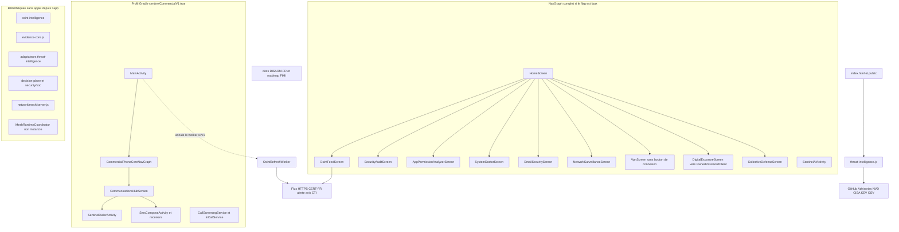

# Cartographie d’architecture

Lecture du commit `6de5a272e0302ad1eccc6c2215157b13f97d485c`. Le schéma décrit des **raccordements lus dans le code**. Il ne décrit pas un système en fonctionnement. **COMMERCIAL NO-GO.**

## Schéma

Le trait pointillé est une coupure lue dans `MainActivity`, `SentinelApplication` et `OsintRefreshWorker`. Le manifeste `src/v1Commercial/AndroidManifest.xml` retire en plus l’activité IA, le Studio voix, le listener Wear, Auth0, le service WireGuard et des permissions radio.

## Attendu et présent

« Attendu » reprend le nom demandé dans la mission et le statut écrit dans les registres. « Présent » est le raccordement lu. Ce n’est pas une recette.

| Attendu | Écrit dans le dépôt | Présent au commit lu |
| --- | --- | --- |
| Phone Core V1 | Matrice : inclus, NO-GO. Registre : implemented, pas disponible client. | Activités et services télécom dans le manifeste, hub commercial qui les ouvre. Rôles et appareil non vérifiés. |
| Flux OSINT CERT-FR | Registre : implemented, non vérifié. | Client RSS et écran du graphe complet. Coupé en V1. Réseau non appelé. |
| FIMI / DISARM-FR | Catalogue : planifié, pas à vendre. Document de conception. | Pas de taxonomie. Bibliothèque d’évaluation dormante. |
| Threat intelligence serveur | Registre d’intégration : sources publiques partielles, verrouillé. | Adaptateurs et page web. Clés MalwareBazaar et VirusShare absentes. |
| Cybersécurité Android | Nom d’écran et de page web. | Audit du propre paquet, hors V1. |
| Audit des permissions installées | Écran du graphe complet. | Code `PackageManager`, hors V1, visibilité des paquets non prouvée. |
| Analyse e-mail | Matrice V1 : EXCLUDE. | Analyseur local d’un message collé ou partagé, hors V1. |
| Analyse SMS | Matrice V1 : inclus. | Analyseur appelé par le receiver et le composeur, y compris le profil dont le manifeste garde ces composants. |
| System Doctor / nettoyage | `PHYSICAL_REQUIRED`. | Diagnostic et cache de l’app, hors V1. Pas un nettoyage système. |
| Mises à jour automatiques | Drapeau false, bibliothèque non importée. | Pas de mécanisme de mise à jour de l’APK. |
| Wi-Fi / Bluetooth | Matrice V1 : EXCLUDE. Registre : validation physique. | Scanners et écran hors V1. Permissions retirées du manifeste V1. |
| SOC | Désactivé par politique. | Bibliothèques sans entrée. |
| Défense collective | Implemented non vérifié. | Écran et worker hors V1. API Python présente. Santé non lue. |
| Exposition numérique | Verrouillée, identité manquante. | Écran mot de passe k-anonyme hors V1. Autre client non instancié. |
| Agent Qwen | Matrice V1 : EXCLUDE. | Activité hors V1. Poids absents du dépôt. |
| VPN | Implemented non configuré. Matrice : EXCLUDE. | Écran hors V1 sans action de connexion. Service retiré en V1. |
| Mesh | Implemented non configuré, backend non déployé. | Serveur et classes Kotlin. Pas d’appel depuis l’UI. |
| Site | Pages publiques et registre de vérité produit. | Fichiers HTML/JS. Déploiement non observé. |
| Wear | Intégration : identité non liée. | Module Gradle `:wear-app`. Service retiré du manifeste V1 de `:app`. |
| Dossiers vides `core/cyber-prediction`, `decision-support`, `geopolitics` | Noms de répertoires. | Aucun fichier. |

## Deux histoires Git

`main` et la ligne `integration/sentinel-v1-commercial-20261118` n’ont pas d’ancêtre commun. Le profil commercial (graphe, manifeste overlay, flag) est sur la ligne integration / `6de5a272`. Il n’est pas sur `main`. Plusieurs bibliothèques OSINT ont le même blob des deux côtés. Le worker CERT-FR sur `main` n’a pas le `return` du flag commercial.

Le schéma ci-dessus est celui de `6de5a272`, pas un fusionné des deux histoires.
